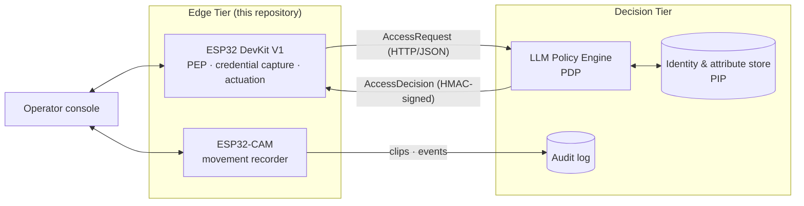
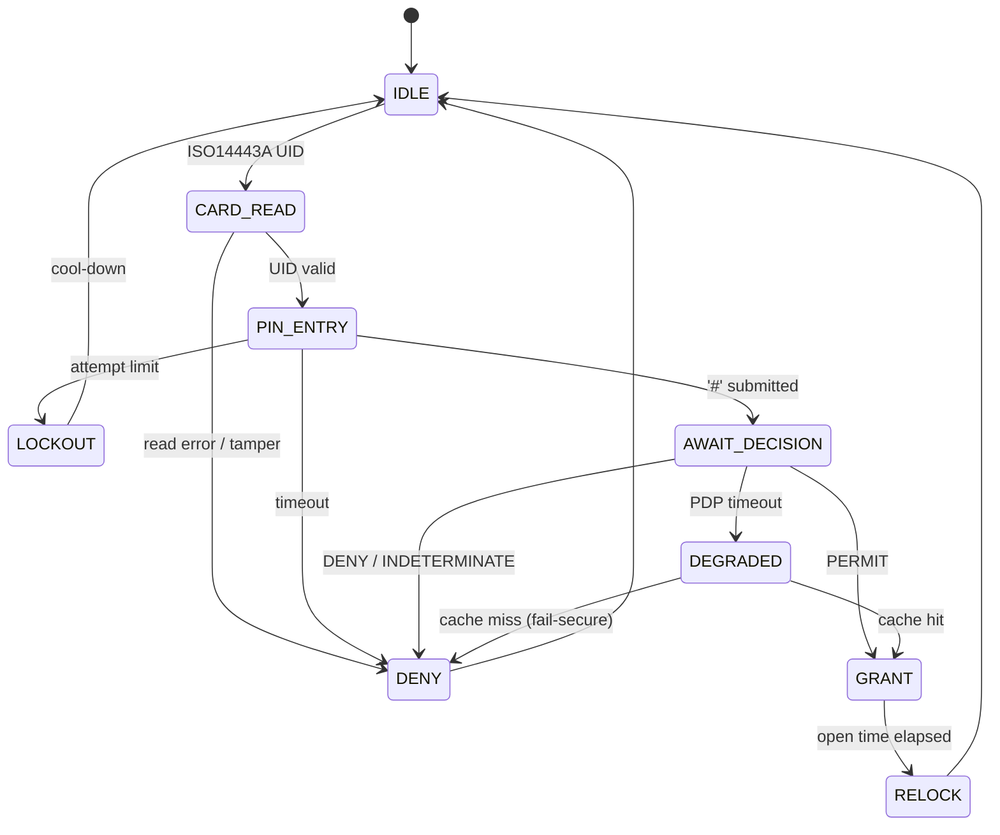

# Smart Gateway — ESP32 Edge Tier for Movement Attestation

Edge hardware and firmware for a two-tier smart-workplace access control system. Each transit through a controlled portal is authenticated with **RFID + PIN** and independently **attested by a camera**, so the system records not only who was granted access but whether a person actually passed through.

The design follows the ABAC reference model of NIST SP 800-162 [1] and the XACML decomposition [2]: an LLM-mediated **Policy Decision Point (PDP)** in the cloud evaluates natural-language policy, while this repository implements the **Policy Enforcement Point (PEP)** and the movement recorder.

| Node | Hardware | Role |
|---|---|---|
| Enforcement | ESP32 DevKit V1 + RC522, 4×4 keypad, LCD 2004A, SG90 servo | Credential capture, latch actuation, audit, HTTP API |
| Recorder | ESP32-CAM (AI-Thinker, OV2640) + microSD | Motion detection, on-device classification, clip storage |
| Console | Single static web page, served by both nodes | Decisions, overrides, live video, event correlation |

The node builds on the RC522/LCD door-access reference of Robotique Site [6, 8], the BanLinhKien RC522 door-lock kit [4] and the `ESP32-CAM_MJPEG2SD` firmware [3]. These are stand-alone, hard-coded locks; here they become a network-attached node that defers every decision to a policy engine and logs every event.

---

## Repository Structure

```
iot-hardware/
├── firmware/
│   ├── gateway-esp32/   # Enforcement node: FSM, RC522, keypad, LCD, servo, HTTP API
│   └── esp32cam/        # Recorder: motion detection, classifier, SD storage, WebDAV
├── console/             # Operator console (index.html) and embedding script (build.py)
└── schematic/           # Schematic/breadboard generator (svggen.py) and EAGLE sheet
```

---

## System Architecture



| Concern | Tier | Rationale |
|---|---|---|
| Credential acquisition, actuation | Edge | Needs physical proximity and bounded latency |
| Movement evidence | Edge | Too much bandwidth to stream continuously |
| Identity resolution, policy evaluation | Decision | Needs the authoritative directory; policies change often |
| Audit retention | Decision | Must be tamper-evident and outlive the device |

The edge node stores no organisational policy. It keeps a small, TTL-bounded **cached authorisation set** so that it can keep working through a network outage, and it **fails secure** (denies) on a cache miss.

---

## Hardware

### Bill of Materials

| Qty | Component | Role |
|---|---|---|
| 1 | ESP32 DevKit V1 (ESP32-WROOM-32, 30-pin) | Enforcement controller |
| 1 | MFRC522 (RC522), 13.56 MHz | ISO/IEC 14443A card reader |
| 1 | 4×4 matrix keypad + 4 × 10 kΩ resistors | PIN entry; pull-ups for input-only column pins |
| 1 | LCD 2004A with PCF8574 I²C backpack [7] | Prompts and status |
| 1 | SG90 micro servo | Latch actuator (stand-in for a solenoid strike) |
| 2 | LEDs (red, green) + 220 Ω resistors | Deny / grant indicators |
| 1 | Passive buzzer | Deny and tamper alarm |
| 1 | Arduino UNO R3 | 5 V bench supply rail |
| 1 | ESP32-CAM (AI-Thinker) + microSD + USB-C MB baseboard | Recorder, powered separately |
| 1 | Breadboard and jumpers | Bench harness |

### Power

The bench has two power domains, and they share **only ground**: the enforcement node and its peripherals run from the UNO's 5 V rail, and the ESP32-CAM runs from its own USB-C.

Worst-case load on the 5 V rail is about **1.16 A**, most of it from a stalled servo (~700 mA). A USB port can supply only 500 mA. Power the servo from a separate 5 V ≥ 1 A supply with a common ground, or feed the UNO through its 7–12 V barrel jack. Use only one supply per board at a time: feeding the UNO `5V` pin or the ESP32 `VIN` while USB is connected back-feeds the host port.

### Pin Assignment (ESP32 DevKit V1)

The RC522 and LCD pins follow [6]. Wire to the **Silkscreen** column, which is the label printed on the board.

| Signal | GPIO | Silkscreen | Notes |
|---|---|---|---|
| RC522 `SDA/SS` / `RST` | 5 / 2 | `D5` / `D2` | VSPI slave select, reset |
| RC522 `SCK` / `MOSI` / `MISO` | 18 / 23 / 19 | `D18` / `D23` / `D19` | Hardware VSPI, 3.3 V supply |
| I²C `SDA` / `SCL` | 21 / 22 | `D21` / `D22` | LCD backpack |
| Servo | 4 | `D4` | LEDC 50 Hz PWM |
| Keypad rows R1–R4 | 13, 14, 27, 26 | `D13`, `D14`, `D27`, `D26` | Scanned outputs |
| Keypad columns C1–C4 | 34, 35, 36, 39 | `D34`, `D35`, `VP`, `VN` | Input-only; external 10 kΩ pull-ups |
| Green / red LED | 25 / 33 | `D25` / `D33` | Grant / deny |
| Buzzer | 32 | `D32` | Active-high |
| Spare | 17, 16 | `TX2`, `RX2` | Unused |

### Schematic and Breadboard

`schematic/svggen.py` generates both figures from a single pin-level netlist. A wire routed to a pin that does not exist fails at generation time. `smart-gateway.sch` (EAGLE 7.3.0) is kept for reference but is out of date.


```bash
sh schematic/schematic.sh   # regenerate after any pin change
```

---

## Firmware

### Enforcement Node — `firmware/gateway-esp32/`

A deterministic finite-state machine with no dynamic allocation and no blocking network I/O, so the time from card presentation to actuation has a fixed upper bound.



Changes from the reference locks [4, 6]:

- **Credentials are evidence, not authorisation.** The UID and PIN go into an access request, and only the PDP can grant. The firmware holds no employee credentials, and a recognised card never toggles the latch.
- **PINs never leave the node in clear.** The PIN is salted with a per-transaction nonce and hashed, and the buffer is zeroed on every state exit. The LCD shows `*` for each digit.
- **Every transition is audited**, including denials, timeouts and tamper events.
- **Decisions are bound to transactions.** A decision whose `txn` does not match the transaction in flight is rejected with `409`, which prevents replay. PDP replies and operator overrides take the same HMAC check (`decisionKey`) and produce the same audit record.

HTTP API on port 80. Mutating routes require an API token, which is generated on first boot and printed once to the serial console.

| Method | Path | Purpose |
|---|---|---|
| GET | `/api/status` | State, door position, current transaction, counters |
| GET | `/api/events?since=` | Audit ring, newest first |
| POST | `/api/decision` | Answer the pending transaction |
| POST | `/api/unlock`, `/api/lock` | Operator override (audited) |
| GET/POST | `/api/acl` | Cached authorisation set |
| POST | `/api/enrol` | Capture the next card UID without granting access |
| GET/POST | `/api/config` | Read / update settings |

Details are in [firmware/gateway-esp32/README.md](firmware/gateway-esp32/README.md).

### Movement Recorder — `firmware/esp32cam/`

Adapts the method of `ESP32-CAM_MJPEG2SD` [3]: the camera compares small greyscale frames to detect motion and passes candidate events through a staged cascade (motion → lightweight classifier → optional Edge Impulse model). Each clip includes pre-roll and post-roll frames, is timestamped with the epoch, is written to SD and is exported over WebDAV. The recorder runs independently of the enforcement node, with no trigger line and no knowledge of credentials. Badge and camera events are matched later, by timestamp, in the console.

Details are in [firmware/esp32cam/README.md](firmware/esp32cam/README.md).

### Operator Console — `console/`

`console/index.html` is a single dependency-free page. `console/build.py` embeds it into both firmwares as `console_ui.h`, and each node serves it at `/`. The page works with either node offline.

| Tab | Node | Contents |
|---|---|---|
| Door | Enforcement | State, pending decision, override, audit log, cached set, enrolment |
| Camera | Recorder | Live MJPEG with motion mask, detections and labels, detector settings |
| Timeline | Both | Credential events matched to motion events by epoch |
| Setup | Both | Node addresses, API token, settings, WiFi |

The Timeline tab is the only place where both kinds of evidence meet. It refuses to match events if either node's clock is unset.

```bash
python -m http.server 8000 --directory console   # local development
python console/build.py                          # regenerate console_ui.h after edits
```

---

## Movement Semantics

| Class | Credential | Motion | Interpretation |
|---|---|---|---|
| 1 — Attested transit | ✓ | ✓ | Normal |
| 2 — Unattested motion | — | ✓ | Tailgating, propped door or intrusion |
| 3 — Unconsummated grant | ✓ | — | Credential probing, or a grant that was not used |

Classes 2 and 3 are escalated as anomalies instead of being discarded at the edge.

---

## Getting Started

**Toolchain:** Arduino IDE 2.x or `arduino-cli`, ESP32 core ≥ 2.0.x, libraries `MFRC522` and `ESP32Servo`. The keypad and LCD drivers are implemented non-blocking in `panel.cpp`, so `Keypad` and `LiquidCrystal_I2C` are not required.

1. **Wire and check power.** Confirm 3.3 V at the RC522, the keypad pull-ups, the servo on the 5 V rail and the camera on its own USB-C.
2. **Flash the enforcement node** (board *DOIT ESP32 DEVKIT V1*), note the API token from the serial console, and test the flow by answering decisions from the console's Door tab.
3. **Flash the recorder** (board *AI Thinker ESP32-CAM*, PSRAM enabled). On first boot it opens the `esp32cam-setup` access point at `192.168.4.1`; enter the site WiFi there.
4. **Check correlation.** Confirm both nodes report a valid epoch, then badge in and walk past the camera. The Timeline tab should show a Class 1 transit.
5. **Connect the PDP** and confirm signature verification, including a negative test with a bad signature.

---

## Security Considerations

- **RC522 UIDs can be cloned** and MIFARE Classic Crypto-1 is broken [5]; the PIN and visual attestation compensate on the bench. A production deployment needs cryptographic cards (e.g. MIFARE DESFire EV2/EV3).
- **Bench mode:** clearing the API token lets anyone who can reach port 80 call `/api/unlock`.
- The console sends `Access-Control-Allow-Origin: *`; access is controlled by the API token, not by the page's origin.

---

## References

[1] V. C. Hu *et al.*, *Guide to Attribute Based Access Control (ABAC) Definition and Considerations*, NIST SP 800-162, 2014.

[2] OASIS, *eXtensible Access Control Markup Language (XACML) Version 3.0*, OASIS Standard, 2013.

[3] s60sc, *ESP32-CAM_MJPEG2SD*. https://github.com/s60sc/ESP32-CAM_MJPEG2SD

[4] BanLinhKien, *BLKLab PRJ14 — RFID door lock with Arduino UNO R3*. https://github.com/BanLinhKien/Arduino/blob/main/2_Bo_KIT_Hoc_Tap_Arduino_Uno_R3_RFID_BLK/BLKLab_PRJ14_Cach_Lam_Khoa_Cua_RFID_Bang_Arduino/BLKLab_PRJ14_Cach_Lam_Khoa_Cua_RFID_Bang_Arduino.ino

[5] F. D. Garcia *et al.*, "Dismantling MIFARE Classic," *Proc. ESORICS 2008*, LNCS 5283, Springer, pp. 97–114.

[6] M. A. Haj Salah, *Smart door access control using ESP32 and RFID card*, Robotique Site. https://www.robotique.site/tutorial/smart-door-access-control-using-esp32-and-rfid-card

[7] VDRAM, *Module LCD 20x4 I²C pour Arduino* (WPI450), PCF8574 backpack, default address 0x27. https://www.vdram.com/interfaces-compatibles-arduino/1934-module-lcd-20x4-ic-pour-arduino-retroeclairage-bleu-wpi450.html

[8] Robotique Site, *Smart door access control using Arduino and RFID card* (video). https://youtu.be/AbjD1DNPrNs
